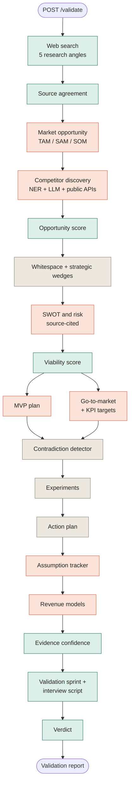
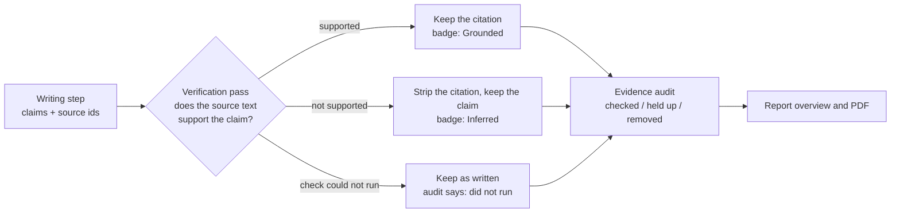
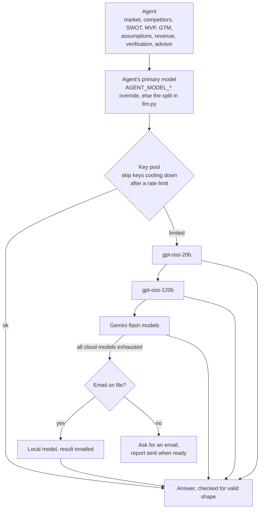
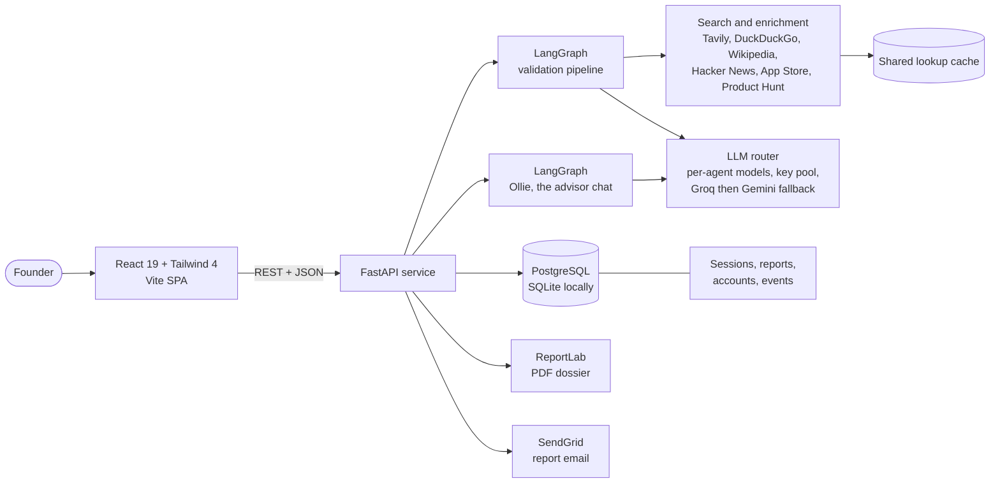

<div align="center">

# Affinity

### Evidence-grounded startup idea validation, powered by a multi-agent AI pipeline

**Before you build it, measure the affinity.**

[](https://github.com/Yasaswini-ch/Development-of-AI-Based-Startup-Idea-Validator-with-Market-Analysis-Assistance/actions/workflows/ci.yml)


[**Live app**](https://startup-validator-frontend-5qcr.onrender.com) ·
[API](https://startup-validator-backend-pruu.onrender.com/health) ·
[Documentation](docs/README.md) ·
[Architecture](docs/architecture.md) ·
[API reference](docs/07_AFFINITY_REST_API_INTERFACE_SPECIFICATION.md)


</div>

---

## Table of contents

- [Overview](#overview)
- [Key capabilities](#key-capabilities)
- [How it works](#how-it-works)
- [Architecture](#architecture)
- [Engineering principles](#engineering-principles)
- [Tech stack](#tech-stack)
- [Getting started](#getting-started)
- [Configuration](#configuration)
- [API](#api)
- [Testing and CI](#testing-and-ci)
- [Deployment](#deployment)
- [Repository layout](#repository-layout)
- [Documentation](#documentation)
- [Contributing](#contributing)

---

## Overview

Most founders validate ideas with gut feel, a few searches and a generic chatbot answer
that sounds confident whether or not it is true. **Affinity** replaces that with a
structured, auditable research pipeline.

A founder describes an idea, a target customer and the problem it solves. In one request,
Affinity searches the live web across five research angles, then runs a LangGraph
pipeline of specialised agents over that evidence. The output is a full validation
dossier: market sizing and segments, competitor landscape, whitespace gaps, SWOT and
risk, viability scoring, MVP scope, go-to-market strategy, experiments, a 7/30/90-day
action plan and unit economics. The report opens in eight tabs: Evidence, Market,
Competitors, Customers, Gaps, Risks, Build & Ship and Roadmap.

Every key claim is labelled **Grounded** (traced to a cited source) or **Inferred**, and
every AI-generated section has a deterministic fallback, so a report is never silently
fabricated and never comes back blank.

## Key capabilities

| Area | What you get |
|---|---|
| **Live market research** | Real-time search across 5 angles (market size, competitors, industry news, customer demand, existing solutions), with per-angle source agreement scoring |
| **Market opportunity** | Market size, trends, and customer segments with pain points, motivations and buying behaviour, grounded in retrieved sources. TAM is sourced; SAM and SOM are sourced when a source states them, otherwise a clearly badged estimate with its assumption shown |
| **Competitive intelligence** | Competitors found from several sources combined (the web search results, local NER, an LLM pass, and Product Hunt, iTunes and Wikidata for enrichment), each labelled direct or indirect, with profiles, an idea-vs-competitor comparison and a positioning grid |
| **Whitespace and strategy** | Evidence-backed market gaps, 5-vector strategic wedge blueprints, and a Market Viability & Dynamics Index |
| **Risk and viability** | Source-cited SWOT, risk register, opportunity score, viability score, contradiction detection and a final verdict |
| **Build and launch plan** | MVP feature recommendations, GTM strategy, validation experiments, a 7/30/90-day action plan, assumption tracker, revenue models (inferred from competitor pricing if the model call fails), pricing tiers and an Alpha/Beta/GA delivery roadmap |
| **Voice of Market** | Direct quotes from what the market actually says, attached to the claims they support |
| **Conversational advisor (Ollie)** | Session-aware follow-up chat with the octopus mascot Ollie. It reuses the validation's evidence and only searches again when the question needs fresh data. It appears on the results page, where a report exists to talk about |
| **Evidence audit** | A second pass re-checks every cited claim against its source text and strips citations the source does not support. The report shows how many claims were checked, how many held up and which lost their citation, and says so when the check did not run |
| **Validation sprint and interview script** | A 4-week sprint (riskiest assumptions, customer interviews, a cheap smoke test, a decision) with pass and fail thresholds, plus a customer-interview script with one probe per risky assumption. Built from the report's own assumptions and experiments, with no extra model call |
| **Interactive report** | A positioning grid where you place your own idea and see how crowded the spot is, a "what would change this verdict" panel that re-scores the verdict from its three inputs in the browser, a competitor pricing table showing where each rival was found, and a "how this report was made" view of the steps, models and timings |
| **Reports** | Publication-ready PDF dossier, email delivery, and side-by-side comparison of saved ideas |
| **Accounts and analytics** | Email or Google sign-in, validation history, comparison matrix and score trends, plus an admin Platform Health dashboard |

## How it works


1. **Submit.** The founder enters an idea, target customer and problem statement.
2. **Research.** The retrieval layer expands the idea into five research angles, queries
   the web (Tavily, falling back to DuckDuckGo, Wikipedia and Hacker News), de-duplicates
   results and filters out low-signal sources.
3. **Analyse.** A LangGraph pipeline runs market, competitor, whitespace, SWOT and
   viability stages over that shared evidence, each grounded in the artifacts produced
   upstream.
4. **Plan.** MVP and GTM agents run in parallel, then contradiction detection,
   experiments, the action plan, assumptions and revenue models are derived from the
   combined results.
5. **Score and deliver.** A confidence dashboard measures source coverage, relevance and
   cross-source agreement, a verdict is computed, and the report is returned to the UI,
   exported as a PDF, or emailed for long-running jobs.

## Architecture


### Validation pipeline

The node graph as implemented in [`backend/agent/graph.py`](backend/agent/graph.py). Orange nodes
call a language model, green nodes are plain code (search, formulas, rules), and grey nodes are rule-based
engines that read earlier results:



MVP and GTM have no dependency on each other, so they fan out from the viability stage
and run concurrently, removing a full LLM round trip from every request's critical path.
Every step is timed, and the steps, their durations and the models that served them are returned
with the report as `pipelineTrace` (shown in the app as "How this report was made").

### How a claim is checked

Each section that cites sources is source-checked before it reaches the report, and the
check records what it did:



### Model routing

LLM calls are routed per agent, then fall through a chain when a model is rate-limited. Groq
limits are per organisation, so extra keys only add capacity when they belong to separate accounts:



### System topology



## Engineering principles

**Grounded by construction.** Every SWOT claim and risk carries a `sourceIds` array that
points to the search results it came from. Source ids the model invents that were never
in its context are dropped before they reach the caller
([`structured_output.py`](backend/agent/structured_output.py)).

**Degrade honestly, never fail blank.** Every LLM-backed agent has a deterministic,
evidence-based fallback ([`deterministic_fallback.py`](backend/agent/deterministic_fallback.py)).
Fallback output is labelled `"degraded": true` and the cause is reported in
`errors.<section>`, so the UI can mark that section while the rest of the report renders.

**Resilient LLM routing.** On a rate limit or failure the router switches immediately to
the next model with its own quota (Groq `qwen3.8-27b`, then `gpt-oss-20b`,
`gpt-oss-120b`, then Gemini Flash), with an optional local Ollama model. Latency and token
usage are logged per call ([`llm.py`](backend/agent/llm.py)).

**Deterministic where it can be.** Whitespace analysis, strategic wedges, scoring,
confidence, contradiction detection, experiments, the action plan and the verdict run
without LLM calls (nine of the 18 agents and engines are plain code). Competitor discovery
starts with local NER, so part of it costs no quota. That keeps cost and latency down and
makes those stages reproducible and testable.

**Stateless, horizontally scalable API.** Sessions, background jobs and the response
cache live in Postgres, so any backend instance can serve any request.

**Observable and protected.** Every request gets an `X-Request-ID` header and a
structured log line. Per-IP rate limits cover validation, chat, auth, PDF export and
email, and inputs are length-bounded at the schema layer. A durable events log powers
the admin Platform Health dashboard.


## Tech stack

| Layer | Technology |
|---|---|
| Frontend | React 19, Tailwind CSS 4, Vite 8, Vitest + Testing Library, oxlint |
| API | FastAPI, Pydantic v2 |
| Orchestration | LangGraph (validation pipeline and a separate advisor chat graph) |
| Agents | CrewAI agents for market, SWOT/risk, MVP, GTM, assumptions and revenue |
| LLMs | Groq (`qwen/qwen3.8-27b` primary, `gpt-oss` fallbacks), Gemini Flash fallback, optional local Ollama |
| Retrieval | Tavily, with a free DuckDuckGo, Wikipedia and Hacker News fallback chain |
| NLP | spaCy `en_core_web_sm` for local competitor entity recognition |
| Persistence | PostgreSQL in production, SQLite locally, via SQLAlchemy 2 |
| Auth | Email/password and Google Sign-In |
| Reports | ReportLab PDF generation, SendGrid email delivery |
| CI/CD | GitHub Actions, Render Blueprint (`render.yaml`) |


## Getting started

### Prerequisites

- Python 3.12 (3.10+ works)
- Node.js 20 and npm
- A [Groq](https://console.groq.com) API key
- Optional: a [Tavily](https://tavily.com) API key for higher-quality search

No database setup is needed locally. When `DATABASE_URL` is unset, the backend uses a
local SQLite file.

### 1. Backend

```bash
cd backend
python -m venv .venv && source .venv/bin/activate
pip install -r requirements.txt
python -m spacy download en_core_web_sm
cp .env.example .env          # set GROQ_API_KEY (and TAVILY_API_KEY if you have one)
uvicorn main:app --reload --port 8000
```

The API is now at `http://localhost:8000`, with interactive docs at
`http://localhost:8000/docs`.

### 2. Frontend

```bash
cd frontend
npm install
cp .env.example .env          # VITE_API_URL=http://localhost:8000
npm run dev
```

Open `http://localhost:5173`.

## Configuration

Secrets are never committed. Set them in `backend/.env` locally and in the Render
dashboard in production.

| Variable | Service | Required | Purpose |
|---|---|---|---|
| `GROQ_API_KEY` | backend | Yes | Primary LLM provider |
| `TAVILY_API_KEY` | backend | No | Primary search provider; free fallbacks are used when unset |
| `GEMINI_API_KEY` | backend | No | Enables the Gemini fallback models |
| `DATABASE_URL` | backend | Prod | PostgreSQL connection string; SQLite when unset |
| `AUTH_SECRET_KEY` | backend | Prod | Signs session tokens |
| `FRONTEND_ORIGIN` | backend | Prod | Allowed CORS origin |
| `GOOGLE_OAUTH_CLIENT_ID` | backend | No | Verifies Google sign-in tokens |
| `SENDGRID_API_KEY`, `SENDGRID_FROM_EMAIL` | backend | No | Report email delivery |
| `ADMIN_EMAILS` | backend | No | Comma-separated accounts with Platform Health access |
| `LLM_MODEL`, `LLM_FALLBACK_MODELS` | backend | No | Override the model chain |
| `GROQ_API_KEYS`, `GEMINI_API_KEYS` | backend | No | Extra keys for the provider pool. A rate-limited key is skipped until its retry time. Keys only add capacity when they belong to separate accounts |
| `AGENT_MODEL_<AGENT>` | backend | No | Pin one agent (market, competitor, swot, mvp, gtm, assumptions, revenue, verification, advisor) to a model |
| `WEB_CACHE`, `TAVILY_DEEP`, `ITUNES_DISCOVERY` | backend | No | Switch the shared lookup cache, Tavily deep search and App Store discovery (all on by default; `0` turns one off) |
| `AGENT_MAX_EXECUTION_SECONDS`, `AGENT_MAX_ITER` | backend | No | Per-agent time and iteration ceilings |
| `*_RATE_LIMIT_PER_MINUTE` | backend | No | Per-IP limits for validate, chat, auth, PDF export and email |
| `DB_POOL_SIZE`, `DB_POOL_MAX_OVERFLOW` | backend | No | Connection pool per instance (default 5/5) |
| `VITE_API_URL` | frontend | Yes | Backend base URL |
| `VITE_GOOGLE_CLIENT_ID` | frontend | No | Shows the Google sign-in button |

## API

The full contract, with field types and error shapes, is in
[`docs/07_AFFINITY_REST_API_INTERFACE_SPECIFICATION.md`](docs/07_AFFINITY_REST_API_INTERFACE_SPECIFICATION.md) and
[`docs/architecture.md`](docs/architecture.md#4-api-contract).

| Method | Endpoint | Description |
|---|---|---|
| `POST` | `/validate` | Run a full validation. Returns the report and a `sessionId`, or `202` with a `jobId` for long runs with email delivery |
| `GET` | `/validate/status/{jobId}` | Poll a background validation job |
| `POST` | `/chat` | Ask the advisor a follow-up question about a session |
| `GET` | `/validate/{sessionId}/pdf` | Download the PDF dossier |
| `POST` | `/export-pdf` | Render a PDF from a validation payload |
| `GET` | `/reports/{sessionId}` | Fetch a saved report |
| `POST` | `/reports/compare` | Compare several saved ideas side by side |
| `POST` | `/reports/{sessionId}/email` | Email a report |
| `POST` | `/auth/signup`, `/auth/login`, `/auth/google` | Authentication |
| `POST` | `/auth/forgot-password`, `/auth/reset-password` | Password reset by emailed single-use link |
| `GET` | `/auth/me`, `/me/history`, `/me/analytics` | Account, history and personal analytics |
| `POST` | `/me/claim-session` | Attach a guest validation to the signed-in account |
| `GET` | `/admin/platform-metrics` | Platform Health (admins only) |
| `GET` | `/health`, `/metrics` | Liveness, database status and service metrics |

**Example**

```bash
curl -X POST http://localhost:8000/validate \
  -H "Content-Type: application/json" \
  -d '{
    "idea": "A subscription box for eco-friendly cleaning products",
    "targetCustomer": "Environmentally conscious households",
    "problem": "Plastic waste from cleaning product packaging"
  }'
```

The response contains `summary`, `results`, `confidence`, `marketOpportunity`,
`competitors`, `whiteSpace`, `swot`, `mvp`, `gtm`, `experiments`, `actionPlan` (with `sprint` and
`interviewScript`), `verdict`, `pipelineTrace`, `errors` and `sessionId`. Sections that
were source-checked carry a `verification` record (see the API reference). Errors use a single shape, `{ "error": "..." }`, with `400` for
invalid input, `429` for rate limits and `502` when every search provider is unavailable.

## Testing and CI

```bash
# Backend: unit, contract, async and concurrency tests (679 at the last full run)
cd backend && python scripts/run_tests.py   # keyless; plain `python -m unittest discover -s tests` also works but loads .env

# Frontend: component tests, lint and production build
cd frontend && npm test && npm run lint && npm run build
```

The full breakdown of what is tested, and what is not, is in [`docs/testing.md`](docs/testing.md).

GitHub Actions ([`.github/workflows/ci.yml`](.github/workflows/ci.yml)) runs the backend
suite, frontend lint and production build on every push and pull request to `staging` and
`main`. The real-provider integration test only runs when `GROQ_API_KEY` is set, so CI
never makes billed LLM calls.

## Deployment


Affinity deploys to [Render](https://render.com) as a Blueprint defined in
[`render.yaml`](render.yaml):

| Resource | Type | Notes |
|---|---|---|
| `startup-validator-backend` | Python web service | Built with the spaCy model; secrets set in the Render dashboard |
| `startup-validator-frontend` | Static site | `npm run build`, pointed at the backend with `VITE_API_URL` |
| `startup-validator-db` | Managed PostgreSQL | Wired to the backend automatically through `fromDatabase` |

Pushes to `staging` deploy automatically. After a deploy, `GET /health` should report
`"database": "postgresql"`.

> **Note:** Render's free PostgreSQL plan expires 30 days after creation. See
> [DEPLOYMENT.md](DEPLOYMENT.md) for provisioning, Google sign-in setup and admin
> configuration.

**Scaling.** All state lives in Postgres, so backend instances can be added from Render's
Scaling tab. The LLM quota is shared across instances, so more instances add concurrency,
not throughput. Keep `instances × (DB_POOL_SIZE + DB_POOL_MAX_OVERFLOW)` below the
database's connection limit.

## Repository layout

```
.
├── backend/
│   ├── main.py                 # FastAPI app: routes, auth, rate limiting, request tracing
│   ├── agent/
│   │   ├── graph.py            # LangGraph validation pipeline
│   │   ├── chat_graph.py       # Advisor chat graph
│   │   ├── retrieval.py        # Multi-angle query expansion, dedup, filtering
│   │   ├── tools.py            # Search providers and fallback chain
│   │   ├── llm.py              # Model routing, fallback, telemetry
│   │   ├── *_agent.py          # Market, competitor, SWOT, MVP, GTM, assumption, revenue agents
│   │   ├── white_space.py      # Whitespace gap analysis (deterministic)
│   │   ├── strategic_wedge.py  # Strategic wedge blueprints
│   │   ├── *_score.py          # Opportunity and viability scoring
│   │   ├── deterministic_fallback.py
│   │   ├── db.py, session_store.py, job_store.py
│   │   └── pdf_exporter.py, email_delivery.py
│   └── tests/                  # Backend test suite
├── frontend/
│   └── src/
│       ├── components/         # Report sections, dashboards, auth UI
│       └── hooks/, mocks/
├── docs/                       # Architecture, API, methodology and runbooks
├── .github/workflows/ci.yml    # CI pipeline
├── render.yaml                 # Render Blueprint
├── DEPLOYMENT.md               # Deployment runbook
└── app.py                      # Legacy Streamlit prototype (not deployed)
```

## Documentation

The [`docs/`](docs/README.md) folder holds the full engineering documentation:

- [System architecture](docs/architecture.md) and [topology and design](docs/04_AFFINITY_SYSTEM_TOPOLOGY_AND_DESIGN.md)
- [Agentic AI and ML engine](docs/05_AFFINITY_AGENTIC_AI_AND_ML_ENGINE.md)
- [REST API specification](docs/07_AFFINITY_REST_API_INTERFACE_SPECIFICATION.md)
- [Confidence and evidence scoring methodology](docs/confidence-and-evidence-scoring-methodology.md)
- [Opportunity score model](docs/15_AFFINITY_OPPORTUNITY_SCORE_MATHEMATICAL_MODEL.md)
- [Five-pillar strategy layer and Google SSO](docs/23_AFFINITY_FIVE_PILLAR_EVIDENCE_STRATEGY_AND_GOOGLE_SSO.md)
- [Security, privacy and ethics](docs/security-privacy-ethics.md)
- [Cost, accuracy and performance metrics](docs/api-cost-accuracy-performance-metrics.md)
- [Operations runbook](docs/09_AFFINITY_CLOUD_DEPLOYMENT_AND_DEVOPS_RUNBOOKS.md)
- [Known limitations and future work](docs/known-limitations-and-future-work.md)

## Contributing

`staging` is the integration branch and `main` is the stable release branch.

1. Branch off `staging`.
2. Make your change with tests, and run the checks in [Testing and CI](#testing-and-ci).
3. Open a pull request into `staging`.
4. Verified changes are promoted from `staging` to `main`.

## License

Released under the [MIT License](LICENSE). Copyright (c) 2026 Yasaswini Chebolu.

---

<div align="center">
Built by <b>Team Nova</b>
</div>
