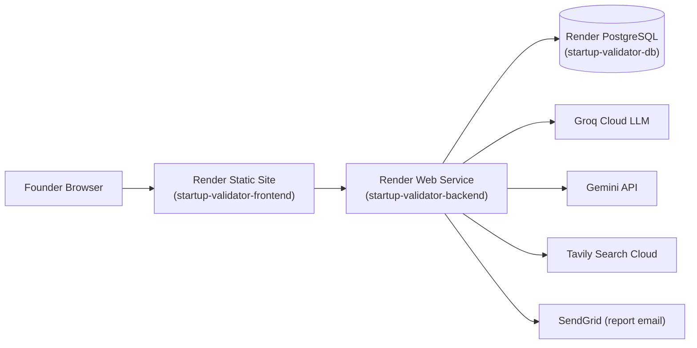

# 09. Deployment & DevOps Infrastructure Guide
**Project:** Affinity — AI-Based Startup Idea Validator with Market Analysis Assistance  
**Document Version:** 3.0 · updated 2026-09-26 against `staging`  
**Status:** Operational  

---

## 📑 Document Table of Contents
- [1. Deployment Architecture Overview](#1-deployment-architecture-overview)
- [2. Render Infrastructure (`render.yaml`)](#2-render-infrastructure-renderyaml)
- [3. Environment Variables & Secrets Management](#3-environment-variables--secrets-management)
- [4. Operational Incident Playbooks](#4-operational-incident-playbooks)
- [5. Diagnostic & Monitoring Commands](#5-diagnostic--monitoring-commands)

---

## 1. Deployment Architecture Overview

Affinity is deployed on **Render** as two web services and one database:
1. `startup-validator-backend`: Python FastAPI service executing the LangGraph agent pipeline.
2. `startup-validator-frontend`: Static web application built with React and Vite.
3. `startup-validator-db`: PostgreSQL (free plan) holding accounts, validation sessions,
   jobs, the response cache and the admin event log.



The step-by-step provisioning guide, including the Blueprint-sync gotcha and
`ADMIN_EMAILS` setup, is in [DEPLOYMENT.md](../DEPLOYMENT.md#database-postgresql-on-render).

---

## 2. Render Infrastructure (`render.yaml`)

Production hosting is managed via [`render.yaml`](../render.yaml) (abridged):

```yaml
databases:
  - name: startup-validator-db
    plan: free
    databaseName: affinity
    user: affinity

services:
  - type: web
    name: startup-validator-backend
    runtime: python
    branch: staging
    rootDir: backend
    buildCommand: pip install -r requirements.txt && python -m spacy download en_core_web_sm
    startCommand: uvicorn main:app --host 0.0.0.0 --port $PORT
    envVars:
      - key: AUTH_SECRET_KEY
        generateValue: true
      - key: DATABASE_URL
        fromDatabase:
          name: startup-validator-db
          property: connectionString
      # plus GROQ/GEMINI/TAVILY/SENDGRID keys (sync: false) and FRONTEND_ORIGIN

  - type: web
    name: startup-validator-frontend
    runtime: static
    branch: staging
    rootDir: frontend
    buildCommand: npm install && npm run build
    staticPublishPath: dist
```

> [!WARNING]
> `render.yaml` only takes effect through a **Blueprint sync**. A database declared here
> is not created until the Blueprint is synced, and services originally created by hand
> ignore this file. Confirm `GET /health` reports `"database": "postgresql"` after any
> infrastructure change.
>
> Render's free PostgreSQL **expires 30 days after creation**. Track the date and
> upgrade or recreate the database ahead of any demo.

---

## 3. Environment Variables & Secrets Management

| Variable | Target Service | Mandatory? | Value / Description |
|---|---|---|---|
| `GROQ_API_KEY` | Backend | **Yes** | Cloud API key for Groq LLM inference (Set in Render Dashboard) |
| `TAVILY_API_KEY` | Backend | Optional | API key for Tavily Search (DuckDuckGo fallback used if absent) |
| `GEMINI_API_KEY` | Backend | Recommended | Gemini models at the end of the LLM fallback chain, the chat advisor default, and competitor refinement |
| `FRONTEND_ORIGIN` | Backend | **Yes** | Allowed CORS origin (e.g., `https://startup-validator-frontend.onrender.com`) |
| `DATABASE_URL` | Backend | **Yes** in production | Postgres connection string, linked from the Blueprint database. Unset → local SQLite (not persistent on Render) |
| `AUTH_SECRET_KEY` | Backend | **Yes** in production | Signs login JWTs. Generated by the Blueprint; rotating it signs everyone out |
| `ADMIN_EMAILS` | Backend | Optional | Comma-separated emails promoted to admin (Platform Health access). Set by hand in the dashboard |
| `REQUIRE_PERSISTENT_DB` | Backend | Optional | `1` makes startup fail instead of falling back to SQLite |
| `SENDGRID_API_KEY` / `SENDGRID_FROM_EMAIL` | Backend | Optional | Report email delivery |
| `VITE_API_URL` | Frontend | **Yes** | Production backend API target URL |

> [!CAUTION]
> **API Key Safety:** `GROQ_API_KEY` and `TAVILY_API_KEY` must **never** be committed to Git. They are configured securely via the Render Dashboard environment settings.

---

## 4. Operational Incident Playbooks

### Playbook 1: LLM Failures (rate limits, bad output, provider errors)
- **What the system does:** `kickoff_with_fallback()` in `backend/agent/llm.py` walks the
  chain `groq/qwen/qwen3.8-27b` → `groq/openai/gpt-oss-20b` → `groq/openai/gpt-oss-120b`
  → `gemini/gemini-3.6-flash` → `gemini/gemini-3.8-flash`. It moves to the next model
  immediately on a rate limit, a missing model, a provider/network error (timeouts,
  5xx, auth errors), **or a response that fails the calling agent's shape validation**
  (for example unparseable JSON). Shape validation runs on every attempt, so one
  malformed reply no longer ends the whole chain.
- **When every model fails:** with no email on file, `/validate` returns
  `needsEmailForDeepAnalysis` and asks the user for an email; the retry may then use the
  local Ollama model (`LOCAL_LLM_MODEL`) and finish in the background.
- **Operator action:** check Platform Health → model usage and recent errors. Override the
  chain with `LLM_MODEL` / `LLM_FALLBACK_MODELS` if a provider is down for a long time.

### Playbook 2: Groq Model Deprecation (`model_not_found`)
- **Action:** `_is_model_not_found_error()` automatically advances the fallback chain. Update `DEFAULT_MODEL` / `FALLBACK_MODELS` in `backend/agent/llm.py` (or set `LLM_MODEL` / `LLM_FALLBACK_MODELS` on Render).

### Playbook 3: spaCy Model Missing on Startup
- **Action:** Ensure build command includes `python -m spacy download en_core_web_sm`.

### Playbook 4: Accounts or History Vanished After a Deploy
- **Cause:** the backend fell back to SQLite (no `DATABASE_URL`), or the free Postgres
  database expired.
- **Check:** `GET /health` → `"database"`. If it says `sqlite`, sync the Blueprint and
  confirm `DATABASE_URL` is linked (see DEPLOYMENT.md). If the database is gone,
  recreate it; data is not recoverable on the free tier.
- **Prevent:** set `REQUIRE_PERSISTENT_DB=1`.

### Playbook 5: Admin Can't See Platform Health
- **Check:** the account's email is in `ADMIN_EMAILS` (case-insensitive) on the backend.
  The account is promoted at startup or on its next admin check, so the order of
  sign-up and setting the variable doesn't matter.
- **Then:** sign out and back in so the frontend refreshes `GET /auth/me` → `isAdmin`.

---

## 5. Diagnostic & Monitoring Commands

### Check Backend Process (PowerShell)
```powershell
Get-CimInstance Win32_Process -Filter "Name='python.exe'" | Where-Object { $_.CommandLine -like "*uvicorn*" }
```

### Direct Health Check Probe (cURL)
```bash
curl -i https://startup-validator-backend.onrender.com/health
# {"status":"ok","service":"Affinity API","database":"postgresql"}
```

### Scripted Deployment Check
```bash
cd backend && python scripts/render_deployment_check.py
```
