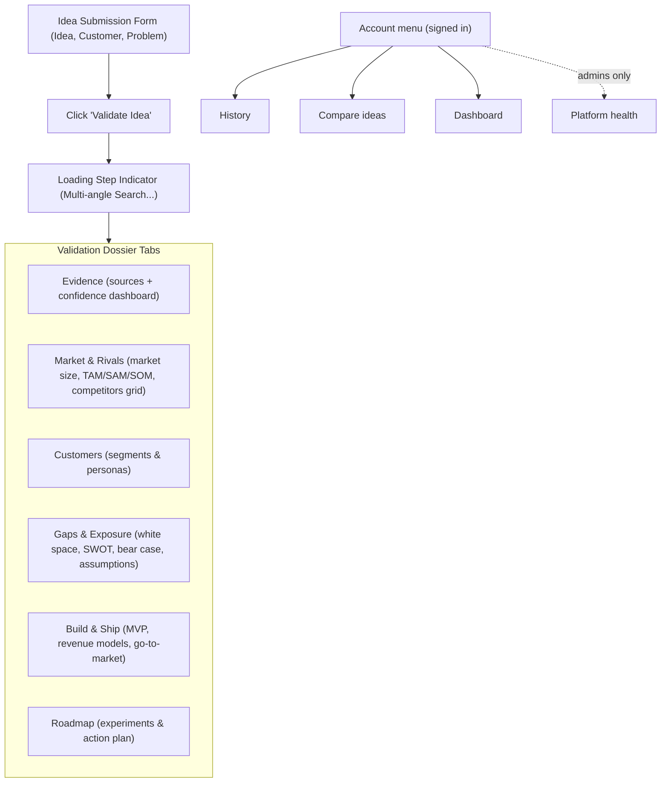

# 10. User Guide & Operations Manual
**Project:** Affinity — AI-Based Startup Idea Validator with Market Analysis Assistance  
**Document Version:** 2.0 · September 2026  
**Status:** Operational  

---

## 📑 Document Table of Contents
- [1. User Interface Overview](#1-user-interface-overview)
- [2. Step-by-Step Validation Walkthrough](#2-step-by-step-validation-walkthrough)
- [3. Phrasing Tips for Best Results](#3-phrasing-tips-for-best-results)
- [4. Interpreting Validation Dossier Outputs](#4-interpreting-validation-dossier-outputs)
- [5. Troubleshooting Common Issues](#5-troubleshooting-common-issues)

---

## 1. User Interface Overview

The Affinity web application features a clean, tabbed interface designed for rapid startup validation:

> Tab names above match the current UI (`ValidationResults.jsx`). Earlier versions of
> this manual described four tabs.

---

## 2. Step-by-Step Validation Walkthrough

### Step 1: Submit Your Idea
1. Open the Affinity web dashboard (e.g. `http://localhost:5173`).
2. **Startup Idea (Required):** Enter a concise 1–2 sentence description of your product concept.
3. **Target Customer (Optional):** Specify the primary demographic or user persona (e.g., *"Freelance photographers"*).
4. **Problem Statement (Optional):** Briefly state the pain point being solved (e.g., *"Manual invoice reminders take hours and clients miss due dates"*).
5. Click **Validate Idea**.

### Step 2: Automated Pipeline Execution
During processing (Milestone 2 measured about 10 seconds for the original pipeline; today's deep mode runs more agents and takes longer, while quick mode is faster), the step indicator displays live status:
- *Step 1:* Expanding idea into 5 research angles...
- *Step 2:* Collecting live web evidence...
- *Step 3:* Evaluating source agreement & market size...
- *Step 4:* Extracting competitors via local spaCy NER...
- *Step 5:* Synthesizing white-space gaps & 0–100 score...

### Step 3: Inspect the Dossier
Review results across the six tabs listed in §1.

### Step 4 (optional): Sign In to Keep a Board of Ideas
Signing in is optional; anonymous validation still works. With an account:

1. Click **Sign in** in the header and create an account (email + password of at least
   8 characters). You stay signed in for up to 30 days.
2. Every idea you validate while signed in is saved to your account.
3. Open the **account menu** (your email in the header). It holds:
   - **History**: your past validations. Use **Add to compare** on up to 5 of them.
   - **Compare ideas**: the ideas you added, side by side (score, viability,
     confidence, market size, competitors, top strength/risk, MVP, positioning).
   - **Dashboard**: four tabs.
     - *Overview*: KPIs (ideas validated, average and best score, high-risk
       assumptions, complete runs, average source agreement) and charts, including a
       radar of the five Market Viability axes (see §4.4).
     - *Comparison matrix*: every idea on the account in one table, best idea marked 🏆.
     - *Validation history*: a detailed list of each run.
     - *Score trends*: your score and source agreement over time.
   - **Platform health**: shown only to admin accounts (see §4.6).
   - **Sign out**.

> Saved validations expire **7 days** after their last update, even on an account.
> Export a PDF of anything you want to keep longer.

---

## 3. Phrasing Tips for Best Results

| Field | Recommended Phrasing | Bad Phrasing (To Avoid) |
|---|---|---|
| **Startup Idea** | *"AI invoice management app that locks photo delivery until client pays balance"* | *"An app for photographers"* (Too vague) |
| **Target Customer** | *"Freelance wedding and portrait photographers"* | *"Everyone"* (Too broad) |
| **Problem Statement** | *"Clients delay final balance payments until weeks after event delivery"* | *"Invoices are annoying"* (Lacks specifics) |

---

## 4. Interpreting Validation Dossier Outputs

### 4.1 Validation Summary & Opportunity Score (0–100)
- **Score > 75 (High Viability):** Strong market CAGR, clear customer pain points, and unaddressed white-space opportunities.
- **Score 50–74 (Moderate Viability):** Viable market, but crowded competitor presence or niche target customer size.
- **Score < 50 (High Competition / Low Signal):** Highly saturated market with few market gaps identified.

### 4.2 Confidence Dashboard
- **Overall** gauge: the share of the sources the analysis actually cites that are
  strongly relevant (relevance ≥ 0.5), shown as e.g. *"6/8 sources agree"*. If nothing
  was cited it says "No cited sources yet" instead of 0/0.
- **Tiles:** source coverage, cross-source agreement, direct evidence, average
  relevance and source recency.
- The full method, including why the overall number is not an average of the tiles, is
  in [confidence-and-evidence-scoring-methodology.md](confidence-and-evidence-scoring-methodology.md).

### 4.3 3x3 Competitor Positioning Grid
- **Vertical Axis (Price):** `Low`, `Mid`, `High`.
- **Horizontal Axis (Feature Breadth):** `Narrow`, `Moderate`, `Broad`.
- **Strategy Tip:** Look for empty cells on the grid. An empty cell indicates a **positioning white-space**.

### 4.4 Market Viability Axes (Dashboard radar)
All five are 0–100:
- **Market demand**, **Execution risk** (lower is better) and **Growth** make up the
  headline Market Viability Score.
- **Competition clarity** is how much is known about competitors (the share whose price
  and feature breadth could both be determined). A low value means "we couldn't see
  the field clearly", not "the field is crowded".
- **Timing** blends growth-trend strength with how recent the sources are.
- Clarity and timing are shown but not added into the headline score, because they
  describe how much is known rather than whether the news is good.

### 4.5 TAM / SAM / SOM
The Market tab shows TAM, SAM and SOM tiles only for figures a source actually
supports, each with its citation. A missing tier means the sources didn't give that
number, not that it's zero.

### 4.6 Platform Health (admins only)
Admins (accounts listed in the backend's `ADMIN_EMAILS`) see a 7/30/90-day view of
total validations, cache hit rate, LLM success rate, deep-analysis rate, average
latency, weekly active users, daily volume, node success rates, model usage, latency
by node, top idea categories, recent errors and email delivery. If the menu item is
missing right after being made an admin, sign out and back in.

---

## 5. Troubleshooting Common Issues

### Issue 1: "Analysis wasn't available for this section"
- **Cause:** Every model in the LLM fallback chain failed for that section (rate limits, provider errors or unusable output).
- **Solution:** Wait 60 seconds and click **Validate Idea** again. Competitor and Evidence tabs remain valid. On a local setup running Ollama, the app may ask for your email so a slower local model can finish the analysis and email it to you; the hosted app doesn't ask.

### Issue 2: Submit Button Is Disabled
- **Cause:** A 5-second cooldown protects the Groq free-tier quota after each submission.
- **Solution:** Wait 5 seconds for the cooldown to clear.

### Issue 3: Stale Dashboard Render
- **Cause:** Browser `sessionStorage` cache.
- **Solution:** Open DevTools Console (F12) and run `sessionStorage.clear()`, then reload.
