# 14. Competitor Positioning & 3x3 Grid Engine Specification
**Project:** Affinity — AI-Based Startup Idea Validator with Market Analysis Assistance  
**Document Version:** 2.0 · September 2026  
**Status:** Verified & Operational  

---

## 📑 Document Table of Contents
- [1. Executive Summary & Design Rationale](#1-executive-summary--design-rationale)
- [2. Local spaCy NER Competitor Extraction](#2-local-spacy-ner-competitor-extraction)
- [3. Entity Filtering & Product Context Rules](#3-entity-filtering--product-context-rules)
- [4. Pricing & Feature Breadth Classification Heuristics](#4-pricing--feature-breadth-classification-heuristics)
- [5. 3x3 Positioning Grid Algorithm](#5-3x3-positioning-grid-algorithm)
- [6. Deep-Mode Competitor Profiles & Parity Grid](#6-deep-mode-competitor-profiles--parity-grid)

---

## 1. Executive Summary & Design Rationale

In early iterations of Affinity, Competitor Discovery was executed by an LLM agent using CrewAI. Live load testing revealed that relying on LLMs for competitor extraction resulted in severe token quota exhaustion and frequent entity hallucinations (e.g. returning generic terms like "Software", "Platform", or outdated entities).

[`backend/agent/competitor_agent.py`](file:///C:/Opensource/AI%20Based%20Startup%20Idea%20Validator/backend/agent/competitor_agent.py) solves this by using **local spaCy Named Entity Recognition (NER)** (`en_core_web_sm`). This non-LLM approach achieves:
- **$0.00 API Token Cost** for competitor *name identification*.
- **Zero Rate-Limit Overhead** on the shared Groq quota, saving it for Market Opportunity/SWOT/MVP/GTM.
- **Factual Grounding**, extracting company and product names directly from live search text.

> **Correction:** name identification is still 100% local NER with no API cost, but
> `_refine_with_gemini()` (added after this doc's "Verified & Operational" status was
> set) optionally fills a genuine `"unknown"` price/featureBreadth gap using a single
> Gemini call per validation run - a separate key/quota (`GEMINI_API_KEY`) from Groq,
> so it still never competes for that budget, but it is a real, optional external API
> call, not $0.00/zero-dependency for the grid fields specifically. Strictly grounded
> in the same local snippet text the regex heuristic uses, and never overrides a value
> the regex already found - see `competitor_agent.py`'s own docstrings for the exact
> contract.

---

## 2. Local spaCy NER Competitor Extraction

```mermaid
flowchart LR
    Snippets["Retrieved Search Snippets"] --> Normalization["1. Join Lines with '. ' (Sentence Boundaries)"]
    Normalization --> NER["2. spaCy en_core_web_sm (Extract ORG Entities)"]
    NER --> Denylist["3. Filter Platform & Generic Denylist"]
    Denylist --> ContextValidation["4. _has_product_context() Validation"]
    ContextValidation --> LocalHeuristic["5. Extract Price & Breadth from Local Context"]
    LocalHeuristic --> Grid["6. Render 3x3 Positioning Grid"]
```



### Line Normalization Fix
A critical bug fix (`046468f`) addressed scraped comparison table snippets. Joining scraped listicle lines with spaces allowed spaCy to merge adjacent lines into garbled multi-word entities. Joining lines with `". "` establishes explicit sentence boundaries, enabling spaCy to identify real competitors cleanly.

---

## 3. Entity Filtering & Product Context Rules

To prevent false positives, `competitor_agent.py` applies three layers of filtering:

### 3.1 Generic Term Denylist (`_GENERIC_WORDS`)
Strips out platform keywords, UI terms, and generic nouns mislabeled as `ORG`:
```python
_GENERIC_WORDS = {
    "android", "ios", "pdf", "reply", "ai", "app", "apps", "software",
    "ratings", "awards", "history", "newsweek", "cbt", "windows", "journal"
}
```

### 3.2 Product Context Validation (`_has_product_context`)
Single-word, non-camelCase candidate entities are accepted **only** if product-ish context (`app`, `software`, `pricing`, `monthly`, `alternative`, `platform`, `tool`) exists nearby in at least one mention:

```python
def _has_product_context(name: str, doc) -> bool:
    for ent in doc.ents:
        if ent.text.strip().lower() == name.lower():
            sentence = ent.sent.text.lower()
            if any(term in sentence for term in _PRODUCT_TERMS):
                return True
    return False
```

- **camelCase Exception:** Distinct multi-word or camelCase names (e.g., `HelloFresh`, `RocketMoney`, `FreshBooks`) bypass the single-word context check.

---

## 4. Pricing & Feature Breadth Classification Heuristics

Rather than guessing prices, Affinity extracts pricing and breadth metrics strictly from the competitor's 2-sentence local text snippet.

### 4.1 Price Classification (`_estimate_price`)
Matches dollar amounts ($) and explicit period keywords (`/month`, `per year`, `a month`, `a year`):
- **`low`:** Pricing under **$15/month** or **$150/year**.
- **`mid`:** Pricing between **$15/month – $50/month** ($150 – $500/year).
- **`high`:** Pricing exceeding **$50/month** or **$500/year**.
- **`unknown`:** If no explicit pricing period match is found in the local context.

### 4.2 Feature Breadth Classification (`_estimate_breadth`)
Pattern-matches feature keywords in local text:
- **`narrow`:** Matches `niche`, `specialized`, `single-feature`, `simple`, `focused`.
- **`broad`:** Matches `all-in-one`, `comprehensive`, `full-suite`, `platform`, `enterprise`.
- **`moderate`:** Default fallback when feature evidence exists without extreme keywords.
- **`unknown`:** If no feature description is available in local text.

---

## 5. 3x3 Positioning Grid Algorithm

Competitors are rendered on a 3x3 matrix in [`frontend/src/components/CompetitorAnalysis.jsx`](file:///C:/Opensource/AI%20Based%20Startup%20Idea%20Validator/frontend/src/components/CompetitorAnalysis.jsx):

```text
               Narrow Breadth     Moderate Breadth     Broad Breadth
High Price   [  Competitor  ]   [  Competitor  ]   [  Competitor  ]
Mid Price    [  Competitor  ]   [  Competitor  ]   [  FreshBooks  ]
Low Price    [  Competitor  ]   [  Competitor  ]   [  Competitor  ]
```

- **Unplaced Competitors:** Competitors with `"unknown"` price or breadth are listed cleanly below the grid rather than being placed arbitrarily.
- **Positioning White-Space:** Empty grid cells highlight direct structural market opportunities for founders.

---

## 6. Deep-Mode Competitor Profiles & Parity Grid

> **Superseded 2026-09-28.** Deep mode no longer only profiles names NER already
> found - `_profile_with_llm` was replaced by `_discover_with_llm`, which can also
> *find* competitors NER missed, grounded back to the source text that named them.
> See [§7](#7-grounded-llm-discovery-2026-09-28) below and
> [competitor-detection-and-confidence-scoring-proposal.md](competitor-detection-and-confidence-scoring-proposal.md).
> §§1–6 below describe the pre-2026-09-28 NER-only/profile-only design and quick-mode
> behavior, which is otherwise unchanged.

*Added 2026-09-26.* Name discovery above is still 100% local NER. In **deep mode**
(`/validate` with `mode` other than `"quick"`), `analyze_competitors(..., profile=True)`
adds one bounded LLM call, `_profile_with_llm`, grounded only in each competitor's own
source text (the same text the price/breadth heuristics read):

| Field | Values |
|---|---|
| `classification` | `direct`, `indirect` or `unknown` |
| `pricing`, `businessModel` | short text (≤80 chars), `"unknown"` when the source is silent |
| `strengths`, `weaknesses` | short lists |
| `gap` | an idea-specific gap, replacing the generic disclosure text |

It also returns a top-level `comparisonMatrix` of at most 5 rows
(`{dimension, idea, competitors: {name: cell}}`); cells for competitor names the model
invented are dropped. On any failure the NER-only result is kept with `profiled: false`,
so profiling can never turn a working section into a failed one.

The frontend shows the extra fields on each competitor card and renders the matrix as
**How your idea compares**, between the cards and the 3x3 grid, with a note that
"unknown" means the sources were silent. The first profiled competitor's weaknesses also
feed the Strategic Wedge's "Incumbent Blindspot" (see
[doc 23 §6](23_AFFINITY_FIVE_PILLAR_EVIDENCE_STRATEGY_AND_GOOGLE_SSO.md#6-pillar-4-5-vector-strategic-wedge-blueprints)).
Tests: `backend/tests/test_competitor_profiling.py`.

---

## 7. Grounded LLM Discovery (2026-09-28)

Review feedback named the local-NER-only cap above (§2: at most `_MAX_COMPETITORS`
names, only ones spaCy's small model actually tags) as one of the project's weakest
points - it could only ever decorate names NER already found, never find ones NER
missed. `_discover_with_llm` replaces `_profile_with_llm` (§6) in deep mode:

1. Every **"Competitors"**-angle search result (not just the subset NER tagged) is
   given to one LLM call, each with a local id (`r1`, `r2`, …).
2. The model returns candidate competitors, each citing which result id(s) it found
   the name in.
3. **Grounding check (`_ground_and_clean_competitors`):** a candidate is kept only if
   its name is literally present (case-insensitive) in the text of a result id it
   actually cited - the same rule `sanitize_source_ids`/`verification.py` apply to
   claims elsewhere in the pipeline. The model can reason over the given text, but
   cannot add a competitor from its own training knowledge. Duplicates are merged
   case-insensitively; the result is capped at `_MAX_COMPETITORS` (raised from 4 to 6).
4. Each surviving competitor keeps its `classification`/`pricing`/`businessModel`/
   `strengths`/`weaknesses`/`gap` fields exactly as §6 describes (`_clean_profile` is
   reused unchanged), plus `estimatedPrice`/`featureBreadth` from the same regex
   heuristics (§3), run over the text of the source(s) the model actually cited for
   that name.
5. **Merge with NER (recall safety net):** any name `_extract_entities` found that
   discovery didn't already cover is appended after the discovered list, up to
   `_MAX_COMPETITORS`, with `classification: "unknown"` - the LLM call has a bounded
   token budget and reads a template prompt, so it can still occasionally miss a name
   NER caught directly from the raw text.
6. On any failure (no results for the Competitors angle at all, `crewai` not
   importable, the call or JSON validation failing, or nothing surviving grounding),
   `_discover_with_llm` returns `None` and `analyze_competitors` falls back to the
   §1–§6 NER-only behavior exactly as before, with `profiled: false`.

**Cost:** this replaces the one bounded LLM call §6 already made in deep mode - it does
not add a call quick mode didn't already skip having. Retrieval also now runs a second
"alternatives"-phrased Competitors query (`agent/retrieval.py`'s `_QUERIES_PER_ANGLE`),
one extra search call per run, to give both NER and discovery more source text to find
names in.

**Enrichment (`_enrich_with_apis`, best-effort, additive):** the top 4 competitors (by
whichever list order they end up in) are looked up against Product Hunt (needs
`PRODUCTHUNT_API_TOKEN`; free apps/software data - tagline, votes, website) and
Wikidata (no key needed; free description/founding-year data for established
companies, only used when the top search hit's own label matches the name exactly). A
match is added as an `"enrichment"` object on that competitor; no match, no key, or
any request failure just means no `enrichment` field for that run, never a broken
response. Product Hunt's public GraphQL schema does not document a plain free-text
search across all posts, so `_producthunt_lookup`'s query is a best effort and should
be verified live once a token is available. The frontend does not render `enrichment`
yet.

**Similar products (2026-09-29):** separately from per-competitor enrichment, `_similar_products`
searches Product Hunt for the *idea text itself* (`posts(query: $name)`, most voted first) and
returns up to 5 products not already listed as competitors under `similarProducts`. Per-competitor
enrichment (`_producthunt_lookup`) keeps a hit only on an exact name match; the idea search does
not need one, since it is looking for products that fit the idea. Because these are Product Hunt's
own hits rather than names grounded in this run's search snippets, they are shown in their own
"Similar products on Product Hunt" section and never feed the Opportunity Score or comparison
grid. Needs `PRODUCTHUNT_API_TOKEN`; absent or on failure the field is simply omitted. Search
quality on a long idea sentence is unverified live.

**Opportunity Score:** a related fix in `opportunity_score.py` - zero found
competitors is no longer scored as a perfect open market; see
[15 Opportunity Score §7](15_AFFINITY_OPPORTUNITY_SCORE_MATHEMATICAL_MODEL.md).

See [competitor-detection-and-confidence-scoring-proposal.md](competitor-detection-and-confidence-scoring-proposal.md)
for the full option comparison this was chosen from. Tests:
`backend/tests/test_competitor_discovery.py`, `backend/tests/test_competition_scoring.py`.
