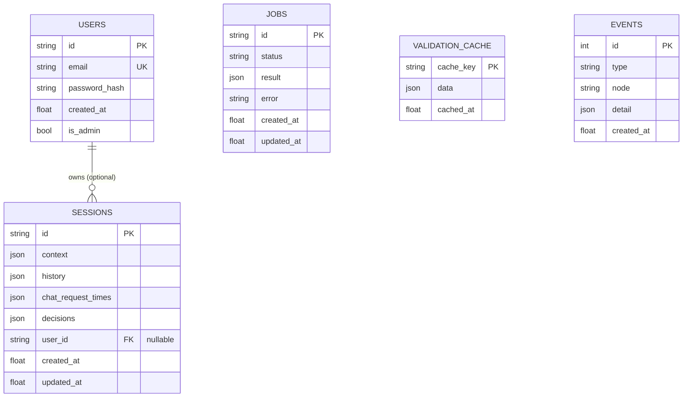

# 19. Milestone 4: PostgreSQL Persistence, Accounts & Admin Access

**Document Version:** 5.0 (updated 2026-09-26 against the `staging` branch)
**Status:** Implemented & Verified
**Target Audience:** Backend Engineers, Operators, Examiners

---

> **Revision history.** Version 3 of this file described a JWT-authenticated, multi-user
> system with team workspaces before any of it existed. Version 4 corrected that by
> stating there was no authentication at all, which was true when it was written.
> Since then, user accounts, JWT auth and an admin role **have** been built, so version
> 4 was itself out of date. This version (5) describes what the code does today.
> There are still **no team workspaces and no role-based access control** beyond a
> single `is_admin` flag. The file name still says "Milestone 3" for historical
> reasons; the work shipped in Milestone 4 and its follow-ups (see
> [doc 22](22_AFFINITY_MILESTONE_5_ANALYTICS_DASHBOARDS_AND_ACCESS_CONTROL.md)).

## 1. Executive Summary & Scope

Before this layer existed, validation sessions, background jobs (the async/email
path), and the `/validate` response cache all lived in process-local Python dicts.
Nothing survived a backend restart, and nothing was shared between backend instances.

`backend/agent/db.py` replaces those in-memory stores with a shared database, and later
work added user accounts and an operational event log on top of it:

- **Postgres in production.** Render provisions it from `render.yaml` and wires
  `DATABASE_URL` into the backend service.
- **SQLite locally and in tests.** When `DATABASE_URL` is unset, the backend uses a
  local `./affinity.db` file, so the test suite never needs a live database.
- **Stateless JWT authentication** (`backend/agent/auth.py`) with email + password
  accounts. Signing in is **optional**: anonymous users can still validate ideas.
- **One admin flag** (`users.is_admin`) that gates the Platform Health dashboard.
- **No migration tool.** `metadata.create_all()` creates missing tables, and a small
  hand-written helper (`_migrate_missing_columns`) adds the few columns that were
  introduced after tables already existed in production.

> ⚠️ **Render free-tier caveat.** Render's free PostgreSQL databases **expire 30 days
> after they are created** (Render gives a short grace period to upgrade before
> deleting it). When that happens, every user account, saved validation and admin flag
> goes with it. For a demo or defense, check the database's creation date in the Render
> dashboard and upgrade or recreate it ahead of time. See
> [DEPLOYMENT.md](../DEPLOYMENT.md#database-postgresql-on-render) and
> [Known Limitations](known-limitations-and-future-work.md).

## 2. Database Schema

Five tables, defined with SQLAlchemy Core in `backend/agent/db.py`:

- **`users`**: one row per account. Email is unique and stored lowercased. Passwords
  are bcrypt-hashed. `is_admin` defaults to false and cannot be set through any
  public endpoint (see §4.3).
- **`sessions`**: one row per validation run. `context` holds the full pipeline output
  (idea, results, marketOpportunity, competitors, swot, mvp, gtm, marketViability,
  verdict, ...). `history` holds the chat advisor transcript. `decisions` holds the
  advisor decision log (`agent/decision_history.py`). `user_id` is set only when the
  `/validate` request carried a valid bearer token; anonymous runs leave it null.
- **`jobs`**: one row per async validation (the "email me when it's done" path).
- **`validation_cache`**: the `/validate` response cache, keyed by a SHA-256 hash of
  the normalized idea/targetCustomer/problem, 30-minute TTL.
- **`events`**: an append-only operational log (node latency, which LLM served each
  call, cache hits/misses, node failures, idea categories, email outcomes). Only
  `agent/events.py` reads or writes it. It backs `GET /admin/platform-metrics`.

All JSON columns use SQLAlchemy's `JSON` type, which stores real JSON on Postgres and
a serialized string on SQLite, so calling code never special-cases the backend.

## 3. Pruning / TTL

| Table | TTL | Row cap | Where |
|---|---|---|---|
| `sessions` | 7 days since last update | 200 rows (oldest dropped) | `session_store._prune` |
| `jobs` | 2 hours | 200 rows | `job_store._prune` |
| `validation_cache` | 30 minutes | none (expired row deleted on read) | `main.py` |
| `events` | 90 days | 200,000 rows | `events._prune` |
| `users` | never pruned | none | — |

> **Note for signed-in users:** the 7-day / 200-row limit applies to **every** session,
> including ones owned by an account. An account itself is permanent, but its saved
> validations (and therefore its Dashboard and History) are only as durable as this
> TTL. This is a known limitation, not a bug; see
> [Known Limitations](known-limitations-and-future-work.md).

## 4. Authentication & Access Control

### 4.1 Accounts and tokens

`backend/agent/auth.py`:

- `POST /auth/signup` and `POST /auth/login` return `{token, user: {id, email}}`.
  Passwords must be at least 8 characters. Login uses one error message for "no such
  account" and "wrong password" so emails can't be enumerated.
- Tokens are HS256 JWTs signed with `AUTH_SECRET_KEY` and valid for **30 days**. Render
  generates this secret automatically (`generateValue: true` in `render.yaml`). Locally
  it falls back to a fixed dev-only key.
- Tokens are stateless, so there is no server-side "log out everywhere" or revocation
  list. Signing out only clears the token from the browser.
- Both auth endpoints are rate-limited per IP (`AUTH_RATE_LIMIT_PER_MINUTE`).

### 4.2 Which endpoints use auth

| Dependency | Behaviour | Used by |
|---|---|---|
| `optional_user` | No header → anonymous. Invalid/expired header → 401. | `POST /validate` (tags the session with `user_id`, and uses the account email for report delivery if none was typed) |
| `require_user` | 401 without a valid token | `GET /auth/me`, `GET /me/history`, `GET /me/analytics` |
| `require_admin` | 401 without a token, 403 for a non-admin | `GET /admin/platform-metrics` |

Endpoints that take a `sessionId` (`/chat`, `GET /reports/{id}`, `POST /reports/compare`,
PDF export, report email) do **not** check ownership. A session id is a random UUID
and acts as a capability link, so anyone who has the link can open that report. This
is deliberate: the emailed "view this report again" link has to work without signing
in.

### 4.3 Becoming an admin

There is no self-service way to become an admin. An operator promotes an account in
one of two ways:

1. **`ADMIN_EMAILS` env var** (comma-separated, case-insensitive). This is the normal
   route on Render, where there is no shell or SQL console on the free tier.
   - On every engine creation (process start), `db._bootstrap_admin_emails` flags every
     existing account whose email is listed.
   - On every admin check, `auth.is_admin` also looks the account up fresh and promotes
     it if its email is listed. This self-healing step exists because, on a host whose
     database is reset by a deploy, the startup bootstrap can run before the matching
     account has been recreated.
2. **Direct SQL**: `UPDATE users SET is_admin = true WHERE email = '...'`.

`is_admin` is never stored in the JWT. It is read from the database on each check, so
revoking admin takes effect immediately. The frontend calls `GET /auth/me` right after
sign-in so the **Platform health** menu item appears without a page reload.

## 5. Persistence Safety Checks

- `GET /health` returns `"database": "postgresql"` or `"sqlite"` (never the URL). On a
  deployed instance, `"sqlite"` means `DATABASE_URL` is missing and data will be lost
  on the next redeploy.
- On Render (`RENDER=true`), falling back to SQLite logs a warning.
- `REQUIRE_PERSISTENT_DB=1` turns that fallback into a startup failure, which is safer
  than silently wiping accounts.
- Render's `postgres://` URLs are rewritten to `postgresql+psycopg://` automatically.

## 6. Connection Pooling (Scale-Out)

Pool size, max overflow, timeout and recycle interval are configurable via
`DB_POOL_SIZE` / `DB_POOL_MAX_OVERFLOW` / `DB_POOL_TIMEOUT_SECONDS` /
`DB_POOL_RECYCLE_SECONDS` (ignored for SQLite). If running more than one backend
instance, keep `instances × (pool_size + max_overflow)` under the database plan's
connection limit.

## 7. What This Still Does *Not* Include

- **No team workspaces or RBAC.** One account = one person's own board. The only role
  is the single `is_admin` flag.
- **No password reset and no email verification.** Both are listed as future work.
- **No token revocation.** A stolen token is valid until it expires (30 days) or
  `AUTH_SECRET_KEY` is rotated (which signs everyone out).
- **No migration tooling.** Schema changes are handled by `create_all()` plus the
  minimal `_migrate_missing_columns` helper. Alembic would be the right next step if
  the schema keeps growing.

## 8. Testing

SQLite backs the test suite, so these tests exercise the layer directly:

- `test_auth.py`: signup/login/me/history, and `is_admin` self-promotion via `ADMIN_EMAILS`.
- `test_admin_bootstrap.py`: startup promotion, case/whitespace handling, no-op cases.
- `test_db_persistence.py`: URL handling, `REQUIRE_PERSISTENT_DB`, the Render warning,
  and the `/health` database field.
- `test_events.py`, `test_platform_metrics.py`, `test_user_analytics.py`: the event log
  and both dashboards' aggregations.
- `test_integration.py` `ConcurrencyTests`: concurrent `/validate`, job and session
  writes across threads with no lost or corrupted rows.
