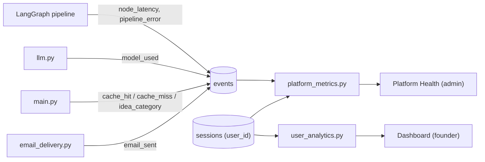

# 22. Milestone 5: Analytics Dashboards & Access Control

**Project:** Affinity — AI-Based Startup Idea Validator with Market Analysis Assistance  
**Document Version:** 1.0 · 2026-09-26 (written against the `staging` branch)  
**Status:** Implemented  
**Target Audience:** Engineers, Examiners, Operators  

---

## 📑 Contents
- [1. Scope](#1-scope)
- [2. Account Menu (navigation redesign)](#2-account-menu-navigation-redesign)
- [3. Founder Dashboard](#3-founder-dashboard)
- [4. Market Viability axes: competitionClarity and timing](#4-market-viability-axes-competitionclarity-and-timing)
- [5. Admin Platform Health](#5-admin-platform-health)
- [6. Durable event log (`events.py`)](#6-durable-event-log-eventspy)
- [7. Access control](#7-access-control)
- [8. Known caveats](#8-known-caveats)
- [9. Tests](#9-tests)

---

## 1. Scope

This milestone turned Affinity from a one-shot validator into a tool a founder can come
back to, and gave operators a view of how the platform is behaving. It covers:

| Feature | Backend | Frontend |
|---|---|---|
| Account menu | `GET /auth/me` (`isAdmin`) | `AccountMenu.jsx` |
| Founder Dashboard (4 tabs) | `GET /me/analytics` → `agent/user_analytics.py` | `AnalyticsDashboard.jsx`, `charts.jsx` |
| Viability axes `competitionClarity`, `timing` | `agent/viability_score.py` | Dashboard radar |
| Admin Platform Health | `GET /admin/platform-metrics` → `agent/platform_metrics.py` | `PlatformHealth.jsx` |
| Durable event log | `agent/events.py`, `events` table | — |
| Admin promotion | `ADMIN_EMAILS`, `auth.is_admin`, `db._bootstrap_admin_emails` | — |

Accounts, JWT auth and the database layer these build on are described in
[doc 19](19_AFFINITY_MILESTONE_3_POSTGRESQL_AUTH_AND_DATA_PERSISTENCE.md). The
comparison views are described in
[doc 21](21_AFFINITY_MILESTONE_3_DEAL_SCREENING_AND_COMPARISON_MATRIX.md).

## 2. Account Menu (navigation redesign)

Before this change the header had four separate pill buttons (History, Compare ideas,
Dashboard, Platform health) next to the account email. They were replaced by a single
account button showing the signed-in email, which opens a dropdown:

- **History**, **Compare ideas**, **Dashboard**: every signed-in user.
- **Platform health**: only when `currentUser.isAdmin` is true.
- **Sign out**.

The menu closes on outside click and on Escape. `isAdmin` comes only from
`GET /auth/me`, never from the login response, so the frontend calls `/auth/me` right
after sign-in; without that, a newly promoted admin didn't see the menu item until a
full page reload. All four destinations are account-only: if a user signs out while on
one of them, the app returns to the landing page, and a non-admin who reaches Platform
Health is bounced as well.

## 3. Founder Dashboard

`AnalyticsDashboard.jsx`, backed by `GET /me/analytics` (bearer token required). All
aggregation happens server-side in `agent/user_analytics.py`, over the account's own
sessions. No LLM calls are made.

| Tab | What it shows |
|---|---|
| **Overview** | KPI cards: ideas validated, average opportunity score, best score (and which idea), high-risk assumptions, complete vs. degraded runs, average source agreement. Charts: opportunity score per idea, a **five-axis viability radar** (§4), assumption risk by category, suggested revenue model distribution, recurring SWOT themes. |
| **Comparison matrix** | Every idea on the account in one table: idea, score, market size, competition label, top risk, revenue model, source agreement, recommendation. Sorted by score; the best idea gets a 🏆. |
| **Validation history** | Per-run detail: target customer, problem, risks, assumptions, revenue models and next steps from the action plan, with Complete/Degraded status. |
| **Score trends** | Opportunity score over time and source agreement over time. |

The "Competition" label buckets the number of named competitors: 0 → *Unclear*, 1–2 →
*Low*, 3–4 → *Medium*, 5+ → *High*. Zero reads as "Unclear" because finding no
competitors may mean thin search coverage, not an empty market. "Recommendation" is a
templated phrase from the score tier (≥70 pursue, ≥45 sharpen positioning, otherwise
consider pivoting) plus the top risk.

The component also contains an anonymous path that aggregates device-local history
client-side, but the app currently only routes signed-in users to the Dashboard.

## 4. Market Viability axes: competitionClarity and timing

`agent/viability_score.py` produces `marketViability` with five 0–100 axes:

| Axis | Meaning | In headline score? |
|---|---|---|
| `marketDemand` | Market size + growth-trend strength (reuses Opportunity Score heuristics) | ✅ weight 0.4 |
| `executionRisk` | Average severity × likelihood of SWOT risks (higher = riskier) | ✅ weight 0.3, as `100 − risk` |
| `growthVelocity` | Growth-trend strength alone | ✅ weight 0.3 |
| `competitionClarity` | Share of named competitors whose price tier **and** feature breadth both resolved (not `"unknown"`). No competitors → 40 | ❌ reported only |
| `timing` | Mean of growth-trend strength and source recency (`100 − medianAgeDays/365·100`). No dated sources → recency 40 | ❌ reported only |

`competitionClarity` and `timing` are deliberately excluded from the headline because
they measure **how much is known**, not whether the news is good or bad. Folding a
data-quality measure into a directional score would mix two different questions.

Where they appear: the Dashboard radar averages all five axes across the founder's
ideas. The Compare Ideas view shows the headline viability score per idea.

> **Not to be confused with the Market Viability & Dynamics Index.** Sprint 1 (merged
> into `staging` on 2026-09-26, after this doc's features) added a separate
> `marketOpportunity.viabilityIndex`: five different axes (Demand Urgency, Expansion
> Velocity, Target Accessibility, Barrier to Entry / Moat, Capital Efficiency) scored
> 1–5 with rationales and citations, shown in the Market tab by
> `MarketViabilityIndex.jsx`. The `marketViability` axes above are unchanged and still
> feed the Dashboard radar.

## 5. Admin Platform Health

`PlatformHealth.jsx`, backed by `GET /admin/platform-metrics?days=7|30|90`
(`require_admin`; `days` is clamped to 1–90).

| Element | Source |
|---|---|
| Total validations | `cache_miss` events (each one is a real pipeline run) |
| Cache hit rate | `cache_hit` / (`cache_hit` + `cache_miss`) |
| API success rate | in-process `metrics.py` success/failure counters for the LLM-backed nodes |
| Deep analysis rate | `pipeline_error` events with `NeedsDeepAnalysisError` ÷ total runs |
| Avg latency | mean of `node_latency` samples (see §8) |
| Active users / week | distinct `sessions.user_id` created in the last 7 days |
| Daily validation volume, cache efficiency over time | per-day event counts |
| Node success rate | in-process counters per node |
| Model usage | `model_used` events: which model served each successful LLM call |
| Latency by node | average `node_latency` per node |
| Top idea categories | `idea_category` events (`agent/idea_category.py`) |
| Recent errors | latest `pipeline_error` rows, with the model chain and outcome |
| Email delivery | `email_sent` events by outcome |

It deliberately does **not** show remaining Groq/Gemini quota. Nothing in the codebase
observes real provider rate-limit headers, so a quota bar would be invented.

## 6. Durable event log (`events.py`)

`agent/metrics.py` holds in-process counters that reset on every restart and can't show
a trend. `agent/events.py` is the durable counterpart: one append-only `events` table
with `type`, optional `node`, a small JSON `detail`, and `created_at`.

| Event type | Written by | Detail |
|---|---|---|
| `node_latency` | `graph._timed` (every node) | `{seconds}` |
| `pipeline_error` | `graph.py` node error handler | `{errorType}` |
| `model_used` | `llm._kickoff_with_metrics` | `{model, elapsedMs}` |
| `cache_hit` / `cache_miss` | `main.py` | — |
| `idea_category` | `main.py` | `{category}` |
| `email_sent` | `email_delivery.py` | `{outcome: sent / failed / skipped_no_config / skipped_invalid_address}` |

Design points:

- `record()` never raises. Losing one metrics row must never fail a validation.
- Pruned on every write: rows older than **90 days** are deleted, and the table is
  capped at **200,000** rows.
- Aggregation is done in Python over a bounded window rather than in SQL, because
  there is no portable way to query inside a JSON column on both SQLite and Postgres,
  and this is an infrequent admin-only read.

## 7. Access control

- Dashboard, History and `/me/*` endpoints: `require_user` (401 without a valid token).
- Platform Health: `require_admin` (401 without a token, 403 for a non-admin).
- `is_admin` is looked up fresh on each check, not carried in the JWT, so revoking it
  takes effect immediately.
- Admins are promoted through `ADMIN_EMAILS` (at startup, and again on each admin check
  so it survives a deploy that resets the database) or by direct SQL. There is no
  self-service path. Setup steps: [DEPLOYMENT.md](../DEPLOYMENT.md#admin-access-admin_emails).

## 8. Known caveats

- **"Avg pipeline latency" is a per-node average.** The KPI averages every
  `node_latency` sample, so it reports the average time of one node, not one full
  validation. Treat it as a relative health signal; use "Latency by node" or
  `scripts/latency_token_measurement.py` for end-to-end numbers.
- **API/node success rates reset on restart.** They come from in-process counters, not
  the event log, so after a redeploy they only cover requests since that restart,
  regardless of the 7/30/90-day filter.
- **Dashboard history is bounded.** Sessions expire after 7 days (200-row global cap),
  so the Dashboard only ever covers recent ideas, even for signed-in users.
- **Free-tier Postgres expiry** (30 days) wipes accounts, sessions and events together.

More in [Known Limitations & Future Work](known-limitations-and-future-work.md).

## 9. Tests

| Area | Tests |
|---|---|
| Account menu | `frontend/src/components/__tests__/AccountMenu.test.jsx` (admin-only item, outside click, Escape, sign out) |
| Admin after sign-in | `frontend/src/__tests__/App.test.jsx` ("shows Platform health after signing in, without a page reload...") |
| Dashboard | `frontend/src/components/__tests__/AnalyticsDashboard.test.jsx` |
| Platform Health UI | `frontend/src/components/__tests__/PlatformHealth.test.jsx` |
| Aggregations | `backend/tests/test_user_analytics.py`, `backend/tests/test_platform_metrics.py` |
| Event log | `backend/tests/test_events.py` |
| Viability axes | `backend/tests/test_viability_score.py` |
| Admin promotion | `backend/tests/test_admin_bootstrap.py`, `backend/tests/test_auth.py` |
