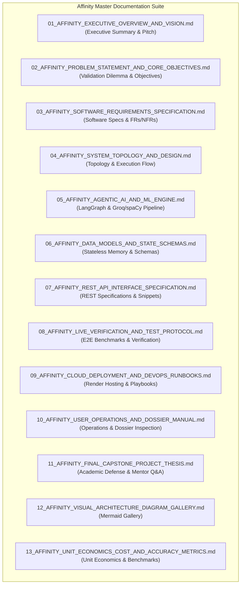

# Affinity Technical Documentation Hub & Master Index
**System Name:** Affinity — AI-Based Startup Idea Validator with Market Analysis Assistance  
**Documentation Version:** 3.1 · updated 2026-09-26 (Milestones 1–4, the analytics/access-control follow-ups, and the five-pillar Sprints 1–4)  
**Verification Status:** Verified & Operational  

---

## 📑 Master Documentation Index

Welcome to the central documentation hub for **Affinity**.

> **Start with [`00_AFFINITY_FINAL_PROJECT_DOCUMENT.md`](00_AFFINITY_FINAL_PROJECT_DOCUMENT.md)**,
> the single document that describes the whole project as it stands (updated 2026-10-02).
>
> **Two doc sets, one system.** This folder has a numbered set (`00`–`23`, written as a
> formal report) and a lowercase set (`architecture.md`, `frontend-spec.md`, ...) that
> engineers update alongside code. They overlap. **Where they disagree, the lowercase doc
> and the code win.** The API reference now lives only in doc 07 (the former
> `api-reference.md` was a duplicate with the same gaps and was removed), and the
> runbook only in doc 09. Dated logs (`milestone*-verification.md`, `track-f-*`, doc 08)
> record what was true at the time and are intentionally not updated. See
> [Known Limitations §5](known-limitations-and-future-work.md#5-documentation-two-overlapping-doc-sets-process-lesson).
>
> | Numbered doc | Lowercase counterpart (authoritative) |
> |---|---|
> | 04 System topology, 12 Diagrams | [`architecture.md`](architecture.md) |
> | 05 AI/ML engine | [`prompt-engineering-agent-design.md`](prompt-engineering-agent-design.md), [`architecture.md` §2](architecture.md#2-agent-breakdown) |
> | 06 Data models, 07 REST API | [`architecture.md` §4](architecture.md#4-api-contract) (07 is authoritative for the route list) |
> | 09 Deployment runbooks | [`../DEPLOYMENT.md`](../DEPLOYMENT.md) |
> | 10 User manual | [`frontend-spec.md`](frontend-spec.md) (UI), doc 22 (dashboards) |
> | 13 Unit economics | [`api-cost-accuracy-performance-metrics.md`](api-cost-accuracy-performance-metrics.md) |
> | 17 Roadmap | [`product-strategy-and-personas.md`](product-strategy-and-personas.md), [`known-limitations-and-future-work.md`](known-limitations-and-future-work.md) |
> | 19 Persistence & auth | [`security-privacy-ethics.md`](security-privacy-ethics.md), [`../DEPLOYMENT.md`](../DEPLOYMENT.md#database-postgresql-on-render) |
> | Confidence (mentioned in 03, 05, 10) | [`confidence-and-evidence-scoring-methodology.md`](confidence-and-evidence-scoring-methodology.md) |
> | 23 Five pillars & Google SSO | [`architecture.md` §2](architecture.md#five-pillar-post-processors-sprints-14), [`known-limitations-and-future-work.md` §7](known-limitations-and-future-work.md#7-five-pillar-features) |

---

## 📚 Core Documentation Modules

| # | Document | Target Audience | Primary Focus |
|---|---|---|---|
| **00** | [`00_AFFINITY_FINAL_PROJECT_DOCUMENT.md`](00_AFFINITY_FINAL_PROJECT_DOCUMENT.md) | Everyone | The single final document for the whole project: features, pipeline, agents, tools, reliability, open items, how to run. Start here. |
| **01** | [`01_AFFINITY_EXECUTIVE_OVERVIEW_AND_VISION.md`](01_AFFINITY_EXECUTIVE_OVERVIEW_AND_VISION.md) | Executive / All | Core mission, value proposition, key stakeholders, and system highlights. |
| **02** | [`02_AFFINITY_PROBLEM_STATEMENT_AND_CORE_OBJECTIVES.md`](02_AFFINITY_PROBLEM_STATEMENT_AND_CORE_OBJECTIVES.md) | Evaluators / Mentors | Founder validation dilemma, market risks, research questions (RQs), and KPIs. |
| **03** | [`03_AFFINITY_SOFTWARE_REQUIREMENTS_SPECIFICATION.md`](03_AFFINITY_SOFTWARE_REQUIREMENTS_SPECIFICATION.md) | Software Engineers | Functional requirements (FR-01 to FR-10), NFRs, user stories, boundary contracts. |
| **04** | [`04_AFFINITY_SYSTEM_TOPOLOGY_AND_DESIGN.md`](04_AFFINITY_SYSTEM_TOPOLOGY_AND_DESIGN.md) | System Architects | 4-tier topology (React UI, FastAPI Gateway, LangGraph, Cloud AI), sequence diagrams. |
| **05** | [`05_AFFINITY_AGENTIC_AI_AND_ML_ENGINE.md`](05_AFFINITY_AGENTIC_AI_AND_ML_ENGINE.md) | AI Engineers | Hybrid LLM + spaCy NER architecture, Groq model failover chain, token tuning. |
| **06** | [`06_AFFINITY_DATA_MODELS_AND_STATE_SCHEMAS.md`](06_AFFINITY_DATA_MODELS_AND_STATE_SCHEMAS.md) | Backend Engineers | Stateless data lifecycle, Pydantic contracts, SHA-256 30-min volatile caching. |
| **07** | [`07_AFFINITY_REST_API_INTERFACE_SPECIFICATION.md`](07_AFFINITY_REST_API_INTERFACE_SPECIFICATION.md) | Developers | OpenAPI REST endpoints (`/validate`, `/health`), partial failure contracts, code snippets. |
| **08** | [`08_AFFINITY_LIVE_VERIFICATION_AND_TEST_PROTOCOL.md`](08_AFFINITY_LIVE_VERIFICATION_AND_TEST_PROTOCOL.md) | QA / Mentors | 7-industry E2E live verification, forced error-state isolation suite, 16/16 test suite. |
| **09** | [`09_AFFINITY_CLOUD_DEPLOYMENT_AND_DEVOPS_RUNBOOKS.md`](09_AFFINITY_CLOUD_DEPLOYMENT_AND_DEVOPS_RUNBOOKS.md) | DevOps Engineers | Render deployment (`render.yaml`), environment variables, 5 incident playbooks. |
| **10** | [`10_AFFINITY_USER_OPERATIONS_AND_DOSSIER_MANUAL.md`](10_AFFINITY_USER_OPERATIONS_AND_DOSSIER_MANUAL.md) | End Users / Founders | Step-by-step UI walkthrough, pitch phrasing tips, dossier interpretation, troubleshooting. |
| **11** | [`11_AFFINITY_FINAL_CAPSTONE_PROJECT_THESIS.md`](11_AFFINITY_FINAL_CAPSTONE_PROJECT_THESIS.md) | Viva Committees | Capstone academic report, methodology, novelty, team roles, and 7 mentor Q&As. |
| **12** | [`12_AFFINITY_VISUAL_ARCHITECTURE_DIAGRAM_GALLERY.md`](12_AFFINITY_VISUAL_ARCHITECTURE_DIAGRAM_GALLERY.md) | Technical Reviewers | Gallery of 11 GFM-compliant Mermaid diagrams, including accounts/dashboards, the confidence recompute and the LLM fallback chain. |
| **13** | [`13_AFFINITY_UNIT_ECONOMICS_COST_AND_ACCURACY_METRICS.md`](13_AFFINITY_UNIT_ECONOMICS_COST_AND_ACCURACY_METRICS.md) | Technical Lead | Unit economics ($0.00067 paid / $0.00 free), latency breakdown (~10.2s), token metrics. |
| **14** | [`14_AFFINITY_COMPETITOR_GRID_AND_POSITIONING_PARSER.md`](14_AFFINITY_COMPETITOR_GRID_AND_POSITIONING_PARSER.md) | AI / Product | spaCy NER entity discovery, product context checks (`_has_product_context`), 3x3 grid algorithm. |
| **15** | [`15_AFFINITY_OPPORTUNITY_SCORE_MATHEMATICAL_MODEL.md`](15_AFFINITY_OPPORTUNITY_SCORE_MATHEMATICAL_MODEL.md) | Data Engineers | Opportunity Score mathematical derivation ($\text{Score} = \text{Clamp}(50 + S_{\text{mkt}} + S_{\text{growth}} - S_{\text{den}} + S_{\text{gaps}})$, 0-100 bounds). |
| **16** | [`16_AFFINITY_SEARCH_RETRIEVAL_AND_DOMAIN_FILTER.md`](16_AFFINITY_SEARCH_RETRIEVAL_AND_DOMAIN_FILTER.md) | Backend Engineers | 5-angle query expansion, domain exclusion (`_EXCLUDED_DOMAINS`), zero-cost search fallback chain. |
| **17** | [`17_AFFINITY_MILESTONE_3_4_TECHNICAL_ROADMAP.md`](17_AFFINITY_MILESTONE_3_4_TECHNICAL_ROADMAP.md) | Product / DevOps | Technical spec for Milestones 3 & 4 (PDF export, comparison matrix, user accounts, webhooks). |
| **18** | [`18_AFFINITY_ACADEMIC_VIVA_SLIDE_DECK_OUTLINE.md`](18_AFFINITY_ACADEMIC_VIVA_SLIDE_DECK_OUTLINE.md) | Presenters / Evaluators | 20-slide presentation deck outline, speaker notes, and capstone defense Q&A. |
| **19** | [`19_AFFINITY_MILESTONE_3_POSTGRESQL_AUTH_AND_DATA_PERSISTENCE.md`](19_AFFINITY_MILESTONE_3_POSTGRESQL_AUTH_AND_DATA_PERSISTENCE.md) | Database / Security | Postgres/SQLite persistence (`agent/db.py`), optional JWT accounts, the `is_admin` flag and `ADMIN_EMAILS`, retention/TTL, and the free-tier 30-day expiry. No team workspaces. |
| **20** | [`20_AFFINITY_MILESTONE_3_PDF_DOSSIER_EXPORTER_AND_REPORTS.md`](20_AFFINITY_MILESTONE_3_PDF_DOSSIER_EXPORTER_AND_REPORTS.md) | Backend | The ReportLab-only PDF exporter (`agent/pdf_exporter.py`) and its two endpoints, which take no auth header (session ids act as share links). |
| **21** | [`21_AFFINITY_MILESTONE_3_DEAL_SCREENING_AND_COMPARISON_MATRIX.md`](21_AFFINITY_MILESTONE_3_DEAL_SCREENING_AND_COMPARISON_MATRIX.md) | Product | Multi-idea comparison: `POST /reports/compare`, the Compare Ideas view, and the Dashboard's Comparison matrix tab. |
| **22** | [`22_AFFINITY_MILESTONE_5_ANALYTICS_DASHBOARDS_AND_ACCESS_CONTROL.md`](22_AFFINITY_MILESTONE_5_ANALYTICS_DASHBOARDS_AND_ACCESS_CONTROL.md) | Engineers / Examiners | Founder Dashboard (4 tabs), admin Platform Health, `competitionClarity`/`timing` viability axes, the account-menu redesign, and the `events.py` durable log. |
| **23** | [`23_AFFINITY_FIVE_PILLAR_EVIDENCE_STRATEGY_AND_GOOGLE_SSO.md`](23_AFFINITY_FIVE_PILLAR_EVIDENCE_STRATEGY_AND_GOOGLE_SSO.md) | Engineers / Examiners | The five-pillar upgrade: provenance badges, Voice-of-Market quotes, the Market Viability & Dynamics Index, competitor profiles and parity grid, strategic wedges, commercial economics, the MVP delivery roadmap, and Google sign-in. Formulas, schemas, config and gaps. |

---

## 🛠️ Specialized Technical References

In addition to the 23 numbered modules above, the following detailed reference specifications are maintained in this directory:

- [`confidence-and-evidence-scoring-methodology.md`](confidence-and-evidence-scoring-methodology.md) — How the headline confidence % and each evidence tile are computed, and which population each measures.
- [`known-limitations-and-future-work.md`](known-limitations-and-future-work.md) — Retention TTLs, free-tier Postgres expiry, missing email verification, local-model hardware needs, the duplicate-doc-set lesson, and the five-pillar gaps (PDF/email don't include the new sections, template economics, Google sign-in edge cases).
- [`competitor-detection-and-confidence-scoring-proposal.md`](competitor-detection-and-confidence-scoring-proposal.md) — Proposal (not built): grounded LLM competitor extraction vs. NER vs. company APIs, and a more defensible confidence and competition score.
- [`testing.md`](testing.md) — The test overview to show when asked how this is tested: suites and counts, what each group guards, manual checks, and what the tests do not prove.
- [`load-testing-plan.md`](load-testing-plan.md) — How to load-test 5–6 concurrent users, what to measure, and the expected bottlenecks.
- [`scaling-options.md`](scaling-options.md) — The types of scaling the load test can check and the options for each (instance size, workers/queue, LLM quota, database).
- [`milestone4-verification.md`](milestone4-verification.md) — Dated log of bugs found in live testing in September 2026, with root causes, fixes and regression tests.
- [`architecture.md`](architecture.md) — Technical system specification & data contracts.
- [`prompt-engineering-agent-design.md`](prompt-engineering-agent-design.md) — Deep dive into LLM prompt engineering, `reasoning_effort` tuning, and JSON repair.
- [`security-privacy-ethics.md`](security-privacy-ethics.md) — Information security, cryptographic caching, and AI hallucination safeguards.
- [`product-strategy-and-personas.md`](product-strategy-and-personas.md) — Detailed persona profiles, JTBD framework, and GTM strategy.
- [`milestone2-verification.md`](milestone2-verification.md) — Live empirical verification log across 7 distinct startup domains.
