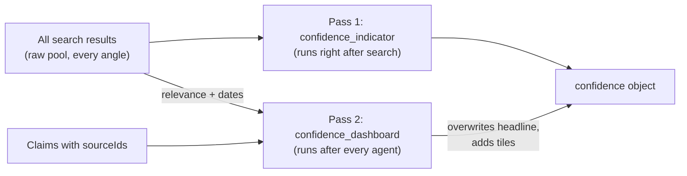

# Confidence & Evidence Scoring Methodology

**Version:** 1.0 · 2026-09-26 (written against the `staging` branch)  
**Code:** `backend/agent/graph.py` (`confidence_node`, `_confidence_dashboard`,
`confidence_dashboard_node`, `_collect_claims`, `_source_relevance_by_id`,
`_source_recency`)  
**UI:** `frontend/src/components/ConfidenceDashboard.jsx`

This is the single authoritative explanation of how Affinity's confidence numbers are
computed. Other docs (03, 05, 10, `product-strategy-and-personas.md`) mention
confidence in passing; where they disagree with this file, this file and the code win.

---

## 1. The short answer

> **Overall confidence** = of the sources the analysis actually **cites**, the
> percentage whose search relevance score is **≥ 0.5**.

It is computed deterministically in Python, with no LLM call. It is **not** the model's
opinion of itself, and it is **not** an average of the tiles shown beside it.

## 2. Inputs

1. **Search results.** Every result from `retrieval.collect()` carries a relevance
   `score` in 0–1 (Tavily's own score, or a computed score for the free fallback
   providers) and, where the provider exposes one, a `publishedAt` date.
2. **Source ids.** When an agent is shown sources, each gets an id `src-1` … `src-N`
   (`compact_sources()`, up to 10 for the market agent). The ids map back to the
   results in the same order, so a cited id resolves to that source's real relevance
   score.
3. **Claims.** Every evidence-backed item carries `sourceIds`:
   - SWOT strengths, weaknesses, opportunities, threats and risks
   - MVP features
   - GTM channels
   - market trends, customer segments, and TAM/SAM/SOM tiers

   Invented ids are stripped (`sanitize_source_ids`), and a verification pass removes
   citations whose snippet does not actually support the claim (`verification.py`).
   So by the time confidence is computed, a citation means "this source exists in this
   run and supports this claim".

## 3. Two passes, and why the headline is overwritten

**Pass 1: `confidence_indicator`** runs before any agent. No claims exist yet, so it can
only ask "how relevant is everything we retrieved?" It counts results with
`score ≥ 0.5` over all scored results, overall and per research angle (`perAngle`).

**Pass 2: `confidence_dashboard`** runs last, after every agent. It **overwrites** the
headline fields (`agreeingSources`, `totalSources`, `percentage`, `label`) with the
same `≥ 0.5` test applied only to the **cited** sources, and adds the breakdown tiles.
`perAngle` from pass 1 is kept unchanged.

**Why overwrite?** The raw pool is 30–50+ results across five angles, including
deliberately broad ones (industry news, customer demand) that were never meant to
match the idea tightly. Measured over that pool, overall confidence sat near zero on
almost every run, however well-evidenced the actual analysis was, because it was
diluted by results the analysis never used. "How relevant are the sources this analysis
is built on" is the honest headline once claims exist. This change was made on
2026-09-24 and is logged in [milestone4-verification.md](milestone4-verification.md).

## 4. Every number, and which population it measures

| Field (UI label) | Formula | Population |
|---|---|---|
| `percentage`, `label` (**Overall**) | cited sources with relevance ≥ 0.5 ÷ cited sources with a known relevance | **Cited sources** |
| `sourceCoverage` (**Source coverage**) | claims with ≥ 1 source ÷ all claims | **Claims** |
| `crossSourceAgreement` (**Cross-source agreement**) | claims with ≥ 2 sources ÷ all claims | **Claims** |
| `directEvidenceRatio` (**Direct evidence**) | claims with a source vs. claims without (direct ÷ total) | **Claims** |
| `averageRelevance` (**Average relevance**) | mean relevance of cited sources | **Cited sources** |
| `sourceRecency` (**Source recency**) | count of results with a known date, and their median age in days | **Raw pool** (all results) |
| `perAngle` | results with score ≥ 0.5 ÷ scored results, per angle | **Raw pool** |

Two consequences worth knowing:

- **Overall and the tiles are not supposed to match.** Overall asks "are the cited
  sources good?"; coverage and agreement ask "is each claim cited, and by how many?".
  An analysis can cite a few excellent sources (high Overall) while leaving many claims
  uncited (low coverage).
- **Source recency is the one tile still measured on the raw pool**, because it reports
  how current the retrieved evidence is overall, and many providers (DuckDuckGo,
  Wikipedia) never supply dates. Market Viability's `timing` axis uses the same recency
  data.

`percentage` values are rounded to whole numbers and are 0 when the denominator is 0.
When nothing was cited, the label reads **"No cited sources yet"** instead of a bare
"0/0 sources agree".

## 5. Worked example

A run retrieves 40 results; 12 have relevance ≥ 0.5.

- Pass 1: 12/40 → **30%** (this used to be the headline).
- The agents produce 24 claims. 18 cite at least one source, 7 cite two or more. Across
  all claims, 8 distinct sources are cited; 6 of them have relevance ≥ 0.5, and their
  mean relevance is 0.71.
- Pass 2 headline: 6/8 → **75%**, label "6/8 sources agree".
- Tiles: coverage 18/24 = **75%**, cross-source agreement 7/24 = **29%**, direct
  evidence 18/24 = **75%**, average relevance **0.71**.

## 6. How the UI reads it

`ConfidenceDashboard.jsx` shows Overall as a gauge with the label under it, and each
tile as a colour-coded bar: ≥ 67% solid (green), 34–66% okay (accent), < 34% needs
attention (red). These colour cut-offs are a display choice only; they don't feed any
score. The founder Dashboard's "Avg
source agreement" KPI and "Source agreement trend" chart use the same `percentage`
field from each saved run.

## 7. Why trust it, and where not to

**Strengths**
- Deterministic and reproducible: the same results and claims always give the same
  numbers.
- Citations are sanitised and verified before counting, so the model can't inflate
  confidence by inventing or misattributing sources.
- Every number is traceable: each claim shows its `src-N` citations and each source its
  URL.

**Limits**
- **Relevance ≠ truth.** A score ≥ 0.5 means a source is on-topic, not that its figures
  are correct. Nothing here fact-checks a source against the world.
- **The 0.5 threshold is a fixed heuristic**, not calibrated against labelled data.
- **Relevance scores are not comparable across providers.** Tavily's score is
  model-based; the fallback providers use a computed score.
- **Small denominators are noisy.** 2/2 = 100% is weak evidence; read `label` alongside
  `percentage`.
- **Runs saved before 2026-09-24** carry the old raw-pool headline, so historical
  Dashboard trends may show a jump at that date.

## 8. Tests

`backend/tests/test_milestone3.py`:
- `test_confidence_dashboard_recomputes_overall_percentage_from_cited_sources_not_the_raw_pool`
- `test_confidence_dashboard_overall_percentage_reflects_weak_cited_sources_too`
- `test_confidence_dashboard_labels_no_citations_honestly_rather_than_a_bare_0_0`

`frontend/src/components/__tests__/ConfidenceDashboard.test.jsx` covers the gauge and
tiles, including recency having its own tile.
